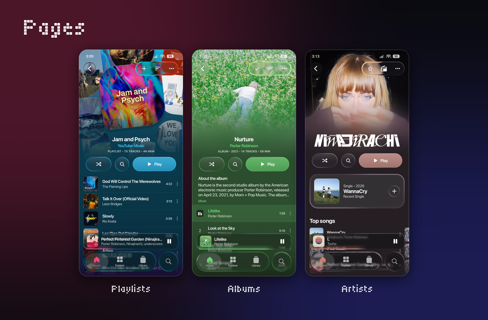
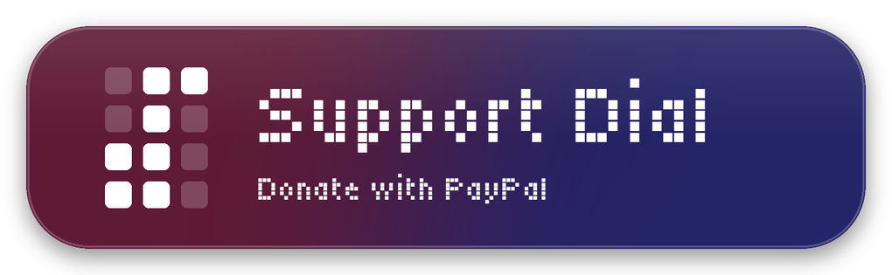

<picture>
  <source media="(prefers-color-scheme: dark)" srcset="docs/dial-logo-dark.png" />
  
</picture>

### Your music is calling

[**Screenshots**](#screenshots) · [**Features**](#features) · [**Install**](#install-and-updates) · [**Credits**](#credits)

> [!NOTE]
> This is a fork of [BitChord](https://github.com/kushagrasinghx/BitChord) by [kushagrasinghx](https://github.com/kushagrasinghx). Everything BitChord does (Hi-Res audio, crossfade, word-synced lyrics, Spotify, scrobbling and the rest) is still here. This page covers what the fork adds or changes. For the full upstream feature list, see the [original README](https://github.com/kushagrasinghx/BitChord#features).

> [!IMPORTANT]
> Not affiliated with, endorsed by, or connected to YouTube or Google in any way. Use it at your own discretion.

---

## Screenshots

---

## Features

### Home
- **Speed dial.** Your pinned songs, albums, playlists and artists in a grid, the first thing you see. Hold a tile to move it or open its menu.
- **Mixes Dial.** A page of mixes from Spotify and YouTube Music, one swipe away.
- **Artist dial.** The artists you pin and play most.
- **I'm Feeling Lucky.** A die that starts a radio from something you've liked or played lately.
- **For You.** New releases, recents and recommendations below the dials.

### Library
- **One library.** Your YouTube Music library, uploads, device files, downloads and Spotify together.
- **Quick to browse.** An A–Z index, list or grid per tab, and a default library to open on.
- **Fix a song's details.** Compare your file with its YouTube Music match and keep the title, artist, album and cover you prefer.

### Player
- **Colours follow the song**, and the player opens out of the mini player.
- **Lyrics.** The current line on the player, or the full synced sheet.
- **Canvas.** Spotify Canvas video behind compact controls.
- **Queue.** What's next, with the controls still in reach.
- **Sideways.** Video on the left, lyrics on the right.

### Customize
- **Theme and style.** System, Light or Dark, in Glass, Frost or Solid, with adjustable transparency, blur and saturation.
- **App icon.** Four colours, dark or bright.
- **Progress bar.** Glow, Wave or Plain.
- **Dials.** Choose the picks, grid size, tile names and tile style.
- **Navigation bar.** Reorder the tabs and choose the start screen.

And more, on top of everything BitChord already does.

---

## Install and updates

Download the latest APK from the [Releases](https://github.com/steeben/Dial/releases) page. Each release has two APK files:

- **arm64-v8a.** For most phones. Try this file first.
- **armeabi-v7a.** For phones with a 32-bit system. Many Android Go phones are in this group. Use this file if the first file does not install.

Before you install, you must permit "Install unknown apps" for the app that you use to download the file.

The app installs as **Dial**, a separate app from the official BitChord, so the two can sit side by side and neither touches the other's data. You'll need to sign in again the first time.

Each release is signed with the same key, so a new version installs over the old one and keeps your sign-in and settings. The app also checks this repository for updates when it launches, and Settings › Miscellaneous › Check for updates asks on demand.

To build it yourself, see [CONTRIBUTING.md](CONTRIBUTING.md).

---

## Credits

This project exists because of [BitChord](https://github.com/kushagrasinghx/BitChord) and its contributors. The lyrics providers, audio sources and everything else it builds on are credited in the [upstream README](https://github.com/kushagrasinghx/BitChord#features). The uploaded-songs fix draws on how [Metrolist](https://github.com/MetrolistGroup/Metrolist) and its InnerTube library handle uploads.

If you like BitChord, consider [supporting its author](https://github.com/kushagrasinghx/BitChord#support).

## Disclaimer

BitChord is an independent, community-driven third-party audio player and client. It is **not** associated with Google LLC, YouTube Music, Deezer, Telegram, or any of their parent companies. It does not host, upload, or store copyrighted music files, and it is provided for personal, educational and fair-use purposes. You are responsible for ensuring your use follows your local copyright laws and the YouTube Terms of Service.

## License

Licensed under the **GNU General Public License v3.0**. See [LICENSE](LICENSE).

---

Dial and all of its features are free. Donations are optional and unlock nothing.

